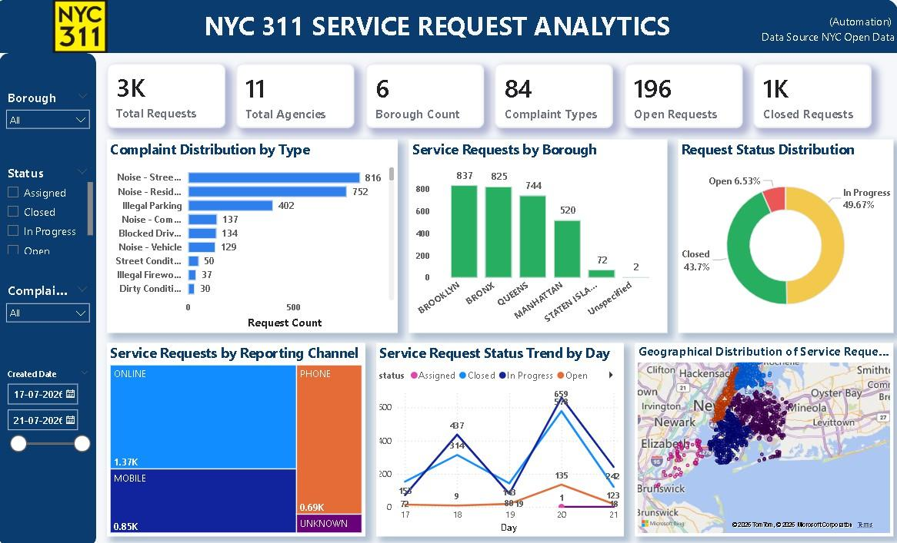
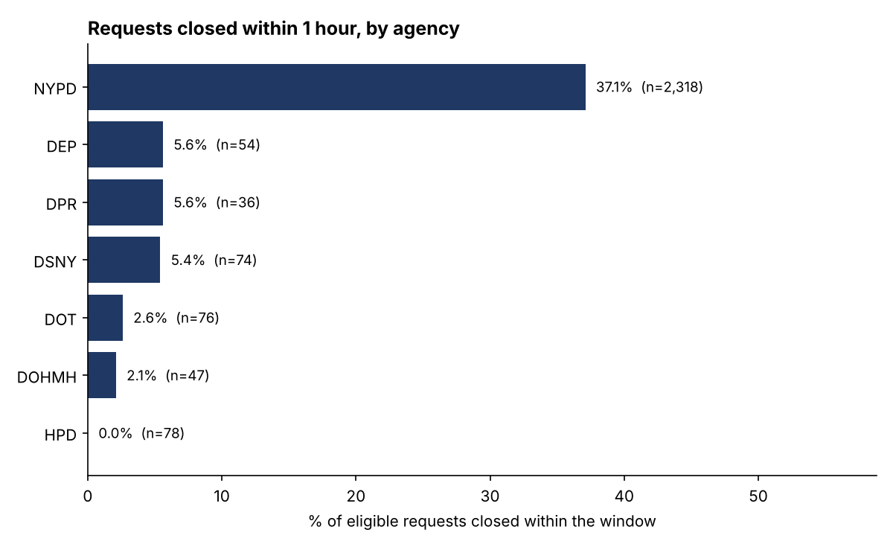
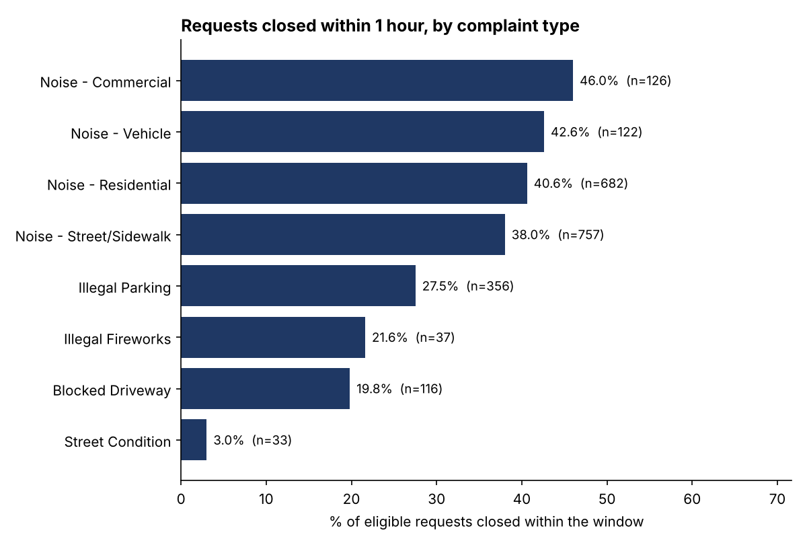

## Dashboard



Power BI dashboard on a 3,000-request sample from the NYC Open Data API: request counts, complaint types, boroughs, status, reporting channel, daily status trend, and a map. The "Closed Requests" card shows 1K because it is rounded; the exact count is 1,311.

## Resolution-Time Analysis (SQL)

### Question
How quickly are NYC 311 requests closed, and does it differ by agency and complaint type?

### Data
- Source: the pipeline's output, `NYC_311_Master_Dataset(Automation).xlsx` (pulled from the NYC Open Data API).
- 6,000 rows, which are **3,000 unique requests** created between 17 Jul 2026 23:34 and 21 Jul 2026 01:54.
- The file holds **three separate pulls of 1,000 requests each**, taken late at night (about 22:20 to 02:56 on three nights). They were loaded 1, 3, and 2 times.

### Method
1. Loaded the data into SQLite and audited it with SQL.
2. Removed exact duplicate rows, leaving 3,000 unique requests.
3. Every request was only watched for a few hours after it was created, so average time to close would look misleadingly fast. Instead I measured the **share of requests closed within 1 hour**, and counted only requests that had been watched for at least 1 hour (2,730 of the 3,000).
4. Compared that share by agency and complaint type, NYPD against all other agencies, and noise against parking complaints inside NYPD.
5. Hid groups with fewer than 30 requests.

The scripts skip analyses the data cannot support: weekday, monthly, and average-days-to-close results need a longer span of data, and the due-date analysis needs a `due_date` column.

### Data quality audit
| Check | Result |
| --- | --- |
| Rows in file | 6,000 |
| Exact duplicate rows | 3,000 (50%) |
| Unique requests | 3,000 |
| Requests with no closed date (still open) | 1,688 |
| Closed before created | 0 |
| Requests with a due date | 0 (the column is not kept by the cleaning step) |
| Created at exactly 00:00:00 | 1 |
| Complaint type labels before / after standardizing | 84 / 84 |

The duplicates are most likely there because the workflow appends every run without checking whether a request is already stored.

### Findings
- **Overall:** 873 of 2,730 eligible requests (32.0%) were closed within 1 hour.
- **By agency:** NYPD closed 37.1% within an hour (859 of 2,318). All other agencies combined closed 3.4% (14 of 412). Among the other agencies with at least 30 requests, the rate ranged from 0.0% (HPD) to 5.6% (DEP and DPR).
- **By complaint type:** noise complaints closed within an hour 38.0% to 46.0% of the time, Illegal Parking 27.5%, Blocked Driveway 19.8%, and Street Condition 3.0%.
- **Inside NYPD:** noise complaints closed within an hour 40.3% of the time (690 of 1,711), against 25.6% for parking complaints (121 of 472).
- **By pull:** 36.8%, 32.8%, and 25.4% for the three nights. With only three nights, I did not draw a conclusion from the differences.




### Recommendations
1. **Fix the pipeline before analyzing more.** Store each request once (match on `unique_key`), keep `due_date`, and pull a continuous multi-week window. The scripts already handle the SLA, weekday, and trend analyses once that data exists.
2. **Do not read the agency gap as performance.** A police response and a street repair are different kinds of work. Re-run with a longer window (for example 24 hours or 7 days) before comparing agencies.
3. **Review parking complaints.** Within NYPD, they close within an hour about 15 points less often than noise complaints (25.6% vs 40.3%), so they are a reasonable first place to look.

### Limitations
- The sample covers three late-night periods only, so it does not represent daytime, other weekdays, or other seasons.
- A 1-hour window captures fast closures only. Work that normally takes longer will look low.
- Each pull's snapshot time is estimated from the latest created time in that pull. The real pull happened at or after that time, so this can only understate how long requests were watched.
- 270 requests were left out because they were created too close to their pull to be watched for a full hour.
- The results show association, not cause, and are not city-wide figures.

### Run it yourself
```bash
pip install -r requirements.txt
python run_sla_analysis.py --input "NYC_311_Master_Dataset(Automation).xlsx"
```
Results are saved as CSV files and charts in `outputs/`. The CSV files import straight into Power BI.
